## 1. Seamless APMGSRN
*Section: Title*

**Seamless APMGSRN**
Blended partition of unity and interface-aware fine-tuning for brick-decomposed neural volumes

**Team:** Devyash Saini (202351030), Deepanshu (202351025), Himanshu (202351047)

Base paper: Wurster, Xiong, Shen, Guo, Peterka. *Adaptively Placed Multi-Grid Scene Representation Networks for Large-Scale Data Visualization.* IEEE TVCG 30(1), 2024 (IEEE VIS 2023). arXiv 2308.02494


> **Speaker notes:** Introduce the project in one sentence: we take a neural volume compressor that splits big data into bricks, and we remove the visible seams between bricks while using fewer overlap cells. Image on the right is the Plume ground-truth volume rendering from our own renderer. Base paper citation: Wurster et al., IEEE TVCG 30(1) 2024, arXiv 2308.02494. Plan for 30 minutes: preliminaries 8 min, problem 4 min, implementation 8 min, results 7 min, extensions 3 min.

---

## 2. Scientific volumes and volume rendering
*Section: Preliminaries*

- A scientific volume stores one scalar per voxel on a regular 3D grid
- Trilinear interpolation gives a continuous field v(x)
- A transfer function maps scalar values to colour and opacity
- Direct volume rendering marches rays and composites front to back

$$C = \sum_i T_i\,\alpha_i\,c_i,\qquad T_i = \prod_{j<i}(1-\alpha_j)$$

Why it matters: a small jump in the field shows up as a visible line in the rendered image.

> **Speaker notes:** Syllabus link: volume rendering integral and its discrete compositing form. Emphasise the last point because the whole project is about small discontinuities that the transfer function makes visible. Our renderer uses 768 samples per ray at 512 by 256 pixels.

---

## 3. Implicit neural representations
*Section: Preliminaries*

- A network f_θ(x, y, z) learns the scalar value at any coordinate
- The weights are the compressed file, so size depends on the model, not on resolution
- Any point can be queried directly, which suits ray marching
- Training: random point batches with L2 loss against trilinear ground truth

$$\min_\theta\ \mathbb{E}_x\big[(f_\theta(x)-v(x))^2\big]$$

Plume raw float32: 32 MiB. Our 8-brick model: 923,136 parameters, 3.52 MiB (about 9× smaller).

> **Speaker notes:** Also called scene representation networks or coordinate networks. The compression number is our own: 512x128x128 float32 is 32 MiB and the model is 923,136 float32 parameters, 3.52 MiB.

---

## 4. Feature-grid encoders
*Section: Preliminaries*

- Pure MLPs learn fine detail slowly, so modern methods store learnable features in a grid
- A query interpolates grid features and a tiny MLP decodes them
- fVSRN: one dense grid. NGP: multiresolution hash grids
- APMGSRN: several small grids that move to where detail is needed

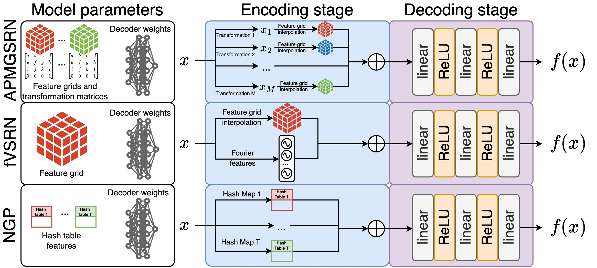

> **Speaker notes:** Figure from the base paper comparing the three encoders. Key idea for the exam: the grid holds most of the parameters, the decoder is tiny. In our model the decoders are only about 4 percent of the parameters, which matters later for the fine-tune.

---

## 5. APMGSRN: adaptively placed grids
*Section: Preliminaries*

- M small feature grids, each with a learned affine transform G_i
- A KL loss pulls the grid density toward a target density derived from the error
- Grid movement stops by 80% of training

$$\rho_i(x) \propto \det(G_i)\,\exp\!\big(-\tfrac12\textstyle\sum G_i(x)^{20}\big)$$

Two optimizers: grids and decoder lr 0.01, transforms 0.05×lr. Decoder: 2×64 MLP.

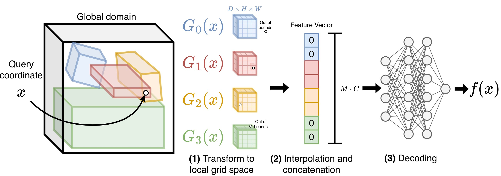

> **Speaker notes:** Architecture figure from Wurster et al. 2024. The power 20 makes the Gaussian flat-topped, so it acts like a soft box marking where the grid sits. Teaser figure in the paper shows grids migrating onto features in Asteroid, Plume, Supernova and Nyx.

---

## 6. Domain decomposition and ghost cells
*Section: Preliminaries*

- Large volumes get split into n×n×n bricks, one independent APMGSRN per brick
- Ghost cells extend each brick into its neighbours
- Hard router at query time: brick = floor((x+1)/2 · n)
- Two models cover the overlap but only one answers each query

```
Brick A  |=========|====|
Brick B       |====|=========|
              ^ overlap  ^ split
```

> **Speaker notes:** Syllabus link: domain decomposition is the standard way to scale volume compression and rendering. The router picks one brick per point, so at the split line the field switches abruptly from model A to model B. In the code the config value plus one equals the actual overlap, so our g1, g4 and g16 names count real cells.

---

## 7. Quality metrics used in this work
*Section: Preliminaries*

| Metric | What it measures |
|---|---|
| PSNR (global, boundary band of 2 cells, interior) | 20·log10(range) − 10·log10(MSE) |
| Render PSNR / SSIM | image quality of the volume rendering |
| Value jump J_v | mean abs difference across each interface |
| Gradient jump J_g | mean abs difference of normal derivative across interfaces (GT floor 1.75e-3) |

> **Speaker notes:** Global PSNR alone hides seams because the boundary band is a tiny fraction of voxels. That is why we added boundary PSNR and the two jump metrics. Render metrics come from our own ray marcher at 512 by 256 with 768 samples per ray, since nerfacc and tcnn were unavailable on this machine.

---

## 8. Seams at brick boundaries
*Section: Problem*

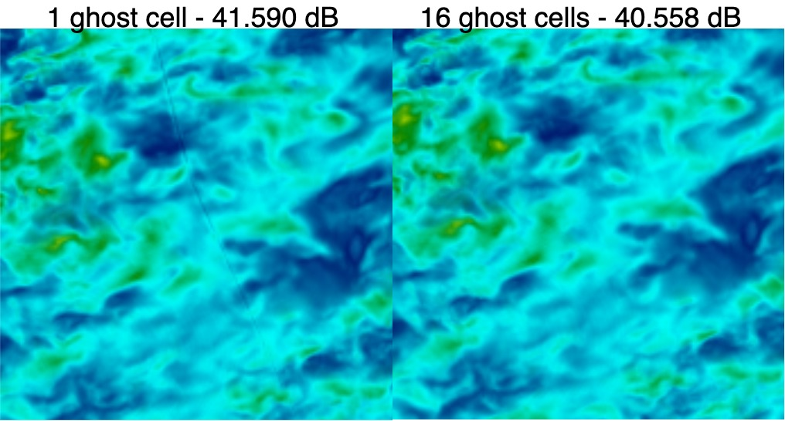

- Independently trained bricks disagree at the split, so the field jumps
- Isosurfaces and shading expose the jump as a crack or line
- The paper uses 16 ghost cells and accepts about 1 dB lower PSNR
- Paper future work: a communication scheme between bricks

> **Speaker notes:** Figure from the base paper. Note the irony: the seam-free version has the lower PSNR. 16 ghost cells on a 256 cubed brick means each model fits 288 cubed, 42 percent more voxels with the same parameters.

---

## 9. Problem statement
*Section: Problem*

**Goal:** match or beat the seam quality of 16 ghost cells using only 2 to 4 ghost cells, with the same model size and the same router.

- Value jump near zero across interfaces
- Higher boundary-band PSNR than the paper setting
- No extra parameters, trained grids unchanged

**Constraints:** RTX 3050 4 GB, about 2 GPU-hours, one week, Plume with 2×2×2 bricks.

> **Speaker notes:** State this slowly. Everything after this slide either builds the method or checks it against this goal.

---

## 10. Reproducing the base paper
*Section: Implementation*

- Cloned the authors' repository and trained APMGSRN locally on Plume
- Adapted the environment for Windows and a 4 GB GPU
- nerfacc and tcnn were unavailable, so we wrote our own PyTorch ray marcher
- Verified the paper's qualitative findings on ghost cells and grid migration

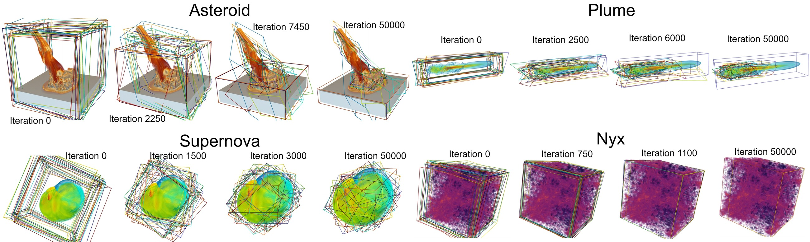

> **Speaker notes:** Keep this short, about one minute. This establishes the reproduced baseline. Teaser figure from the base paper.

---

## 11. Our delta in three parts
*Section: Implementation*

1. **Partition-of-unity blending**: smooth weights that sum to one inside the overlap, no retraining
2. **Interface-consistency fine-tune**: decoders only, 1,500 steps, neighbours agree on values and normal gradients
3. **Seam evaluation suite**: boundary PSNR, value and gradient jumps, render PSNR and SSIM, cost, three seeds

> **Speaker notes:** This answers the paper's future-work item. Blending is the communication between bricks at inference time, the fine-tune is communication at training time.

---

## 12. Partition-of-unity blending
*Section: Implementation*

Per-axis weight of brick i (s = support edge including ghost cells, c = core edge):

$$w_i(q) = S\!\left(\tfrac{q-s_{min}}{c_{min}-s_{min}}\right)\,S\!\left(\tfrac{s_{max}-q}{s_{max}-c_{max}}\right),\quad S(t)=3t^2-2t^3$$

$$F(x)=\frac{\sum_i w_i(x)\,f_i(x)}{\sum_i w_i(x)}$$

- S(t)+S(1−t)=1: weights sum to one, ramp centred on the old split
- Zero slope at the ends: F is C1 across the overlap
- Faces blend 2 bricks, edges 4, corners 8
- Outside the overlap F equals the hard router exactly
- No training, no new parameters

> **Speaker notes:** Smoothstep is the same function used in shader programming, so it is a natural fit for a graphics course. Symmetry S(t)+S(1-t)=1 is the key property: it gives a partition of unity. The 3D weight is a tensor product, which is why edges and corners automatically mix 4 and 8 bricks. Division by the sum makes it robust at the domain border.

---

## 13. Interface-consistency fine-tune
*Section: Implementation*

$$L = L_{rec} + r(t)\,\frac{\lambda_v|f_i-f_j|^2 + \lambda_g|\partial_n f_i-\partial_n f_j|^2}{\text{range}^2}$$

Only the decoders train (about 37k parameters, 4% of the model). Grids and transforms stay frozen.

| Setting | Value |
|---|---|
| Iterations | 1,500 |
| Interface points / step | 4,096 |
| Anchor points / step | 2,048 |
| Learning rate | 5e-4 |
| λv / λg | 1 / 0.05 |
| Warmup | 250 steps |
| Extra time | 4 to 7 min |

> **Speaker notes:** Normal gradients come from autograd on the input coordinates. We also ran a control with the same schedule but only L_rec, called recon fine-tune. That control turns out important on the ablation slide.

---

## 14. Code and evaluation pipeline
*Section: Implementation*

- Blended query wraps the trained per-brick models and plugs into evaluation and rendering
- Hard router kept bit-for-bit identical, checked by a unit test
- 19 CPU unit tests: partition of unity, C1 continuity, corner cases, router equivalence
- One script per stage: train, fine-tune, evaluate, render, benchmark, plot
- All results logged to JSON per seed

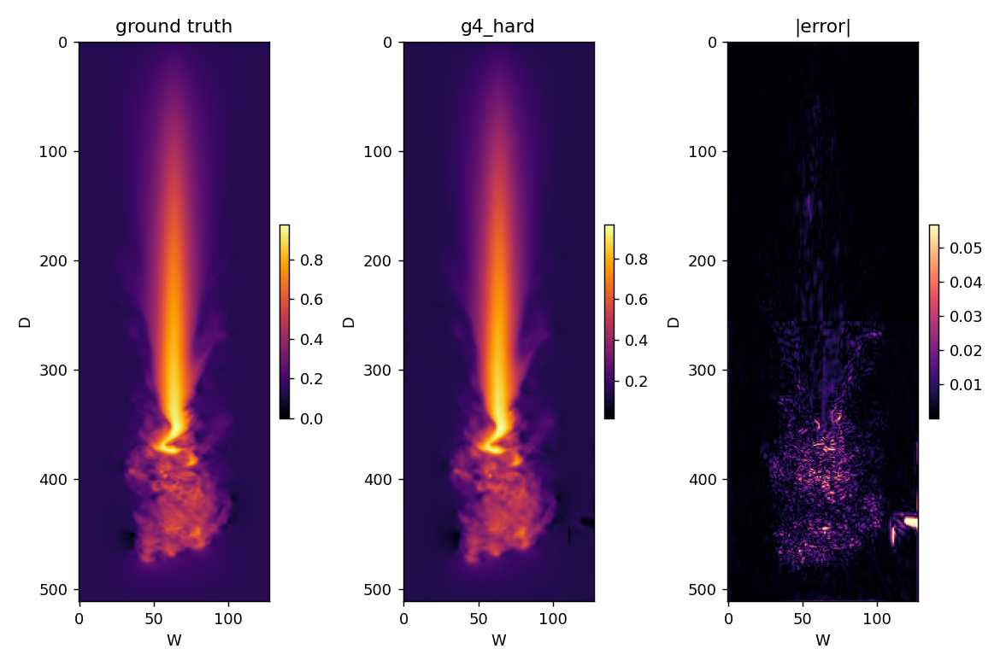

> **Speaker notes:** Work lives on branch seamless-apmgsrn with an isolated worklog. The slice shows why boundary metrics matter: the error lines up with the splits.

---

## 15. Full view: boundary slice error
*Section: Implementation*


> **Speaker notes:** The full-resolution plot makes the boundary-aligned error visible.

---

## 16. Experimental setup
*Section: Results*

| Item | Value |
|---|---|
| Dataset | Plume 512×128×128 |
| Decomposition | 2×2×2 bricks |
| Per brick | 8 grids of 24³, 2×64 decoder |
| Total parameters | 923,136 (3.52 MB) |
| Training | 5,000 it, 32,768 pts/it |
| Seeds | 42, 1, 2 |

- Same model size in every 24³ condition
- Ghost cells named by actual overlap: g1, g4, g16
- g16 also at 27³ and 32³ grids to test capacity
- Total GPU time about 2 h 10 min

> **Speaker notes:** The repo config counts ghost cells one lower than the actual overlap, so config 3 gives g4 and config 15 gives g16. The paper's recommended setting is g16.

---

## 17. Headline result against the paper setting
*Section: Results*

| vs g16 hard (paper setting) | Ours (g4 consistency fine-tune + blend) |
|---|---|
| Global PSNR | +2.00 ± 0.12 dB, 3/3 seeds |
| Boundary PSNR | +2.51 dB |
| Render PSNR | +2.08 dB |
| Value jump | 579× lower |
| Gradient jump | 1.38× lower |
| Extra parameters | 0 |

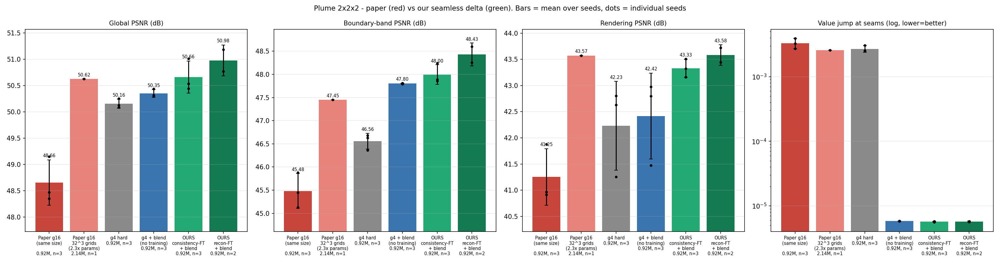

> **Speaker notes:** Paired over seeds 42, 1 and 2: ours wins on every metric on every seed. Ours here means g4 overlap plus consistency fine-tune plus blending.

---

## 18. Full view: headline comparison
*Section: Results*


> **Speaker notes:** Use the enlarged chart for the main quantitative comparison.

---

## 19. Main results on Plume, mean over seeds
*Section: Results*

| Method | Seeds | Params | Global dB | Boundary dB | Render dB | SSIM | Value jump | Grad jump | Mpts/s |
|---|---|---|---|---|---|---|---|---|---|
| g1 hard | 1 | 0.92M | 50.92 | 47.37 | 43.11 | .9919 | 2.64e-3 | 2.89e-3 | 11.5 |
| g4 hard | 3 | 0.92M | 50.16 | 46.56 | 42.23 | .9907 | 2.69e-3 | 2.50e-3 | 11.5 |
| g16 hard (paper) | 3 | 0.92M | 48.66 | 45.48 | 41.25 | .9883 | 3.30e-3 | 2.93e-3 | 11.9 |
| g16, 27³ grids | 1 | 1.30M | 49.57 | 46.53 | 42.23 | .9902 | 2.75e-3 | 3.05e-3 | 11.7 |
| g16, 32³ grids | 1 | 2.14M | 50.62 | 47.45 | 43.57 | .9924 | 2.56e-3 | 2.99e-3 | 11.8 |
| g16 + recon fine-tune | 1 | 0.92M | 49.04 | 46.09 | 42.08 | .9893 | 2.56e-3 | 2.92e-3 | 11.5 |
| g4 blend, no training | 3 | 0.92M | 50.35 | 47.80 | 42.42 | .9911 | 5.81e-6 | 2.15e-3 | 9.2 |
| g4 consistency FT + blend | 3 | 0.92M | 50.66 | 48.00 | 43.33 | .9921 | 5.69e-6 | 2.12e-3 | 9.1 |
| g4 recon FT + blend | 2 | 0.92M | 50.98 | 48.43 | 43.58 | .9924 | 5.71e-6 | 2.14e-3 | 9.6 |

Global PSNR std over seeds: g4 hard ±0.08, g16 hard ±0.43, g4 blend ±0.07, ours ±0.31, recon FT + blend ±0.29.

> **Speaker notes:** Read the table top to bottom: the paper setting is the worst 24 cubed row. Blending alone already brings the value jump down by more than two orders of magnitude. The best row is recon fine-tune plus blend at 50.98 dB. Throughput is median of 7 rounds.

---

## 20. Paired comparisons across seeds
*Section: Results*

| Comparison | Global dB | Boundary dB | Render dB | Value jump | Grad jump | Wins |
|---|---:|---:|---:|---:|---:|---:|
| Ours vs g16 hard | +2.00 | +2.51 | +2.08 | 579× | 1.38× | 3/3 |
| g4 blend vs g16 hard | +1.69 | +2.32 | +1.16 | 567× | 1.36× | 3/3* |
| Ours vs g4 hard | +0.51 | +1.44 | +1.10 | 474× | 1.18× | 3/3 |
| Blend vs g4 hard | +0.20 | +1.24 | +0.19 | 463× | 1.16× | 3/3 |
| Ours vs g16 + recon FT | +1.50 | +1.77 | +1.08 | 445× | 1.32× | 1/1 |
| Recon FT + blend vs g16 + recon FT | +1.73 | +2.17 | +1.36 | 442× | 1.31× | 1/1 |
| Ours vs g16 32³ | −0.09 | +0.40 | −0.41 | 444× | 1.36× | 1/1 |
| Consistency FT vs recon FT | −0.21 | −0.38 | −0.25 | 1.01× | 1.01× | 0/2 |

Paired same-seed differences. *Render PSNR is won on 2/3 seeds.

> **Speaker notes:** Seeds won means our method was better on that metric for that seed. Render PSNR gain vs g16 hard is +2.08 dB, gradient jump is 1.38 times lower, also 3 of 3 seeds.

---

## 21. Rendered images, seed 42
*Section: Results*

| Method | Render PSNR | SSIM |
|---|---|---|
| g16 hard (paper) | 40.97 dB | 0.9876 |
| g4 hard | 42.63 dB | 0.9911 |
| g4 recon FT + blend | 43.44 dB | 0.9922 |
| g4 consistency FT + blend | 43.16 dB | 0.9918 |

 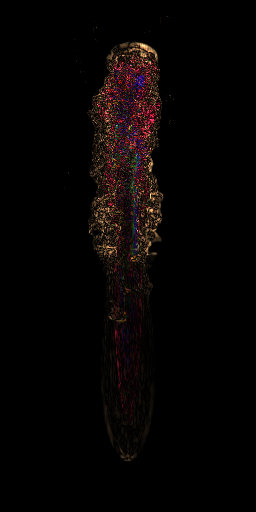
 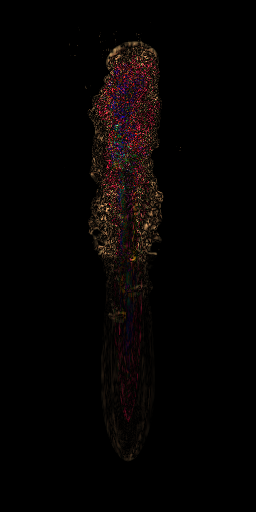
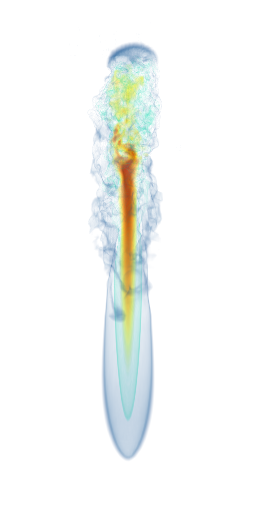 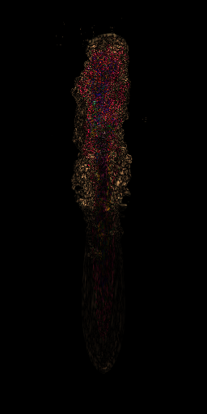

> **Speaker notes:** Point at the seam streak in the g16 error image. The consistency fine-tune variant scores 43.16 dB and 0.9918 on the same seed. Renders from our own ray marcher at 512 by 256 with 768 samples per ray.

---

## 22. How much capacity does g16 need to catch up
*Section: Results*

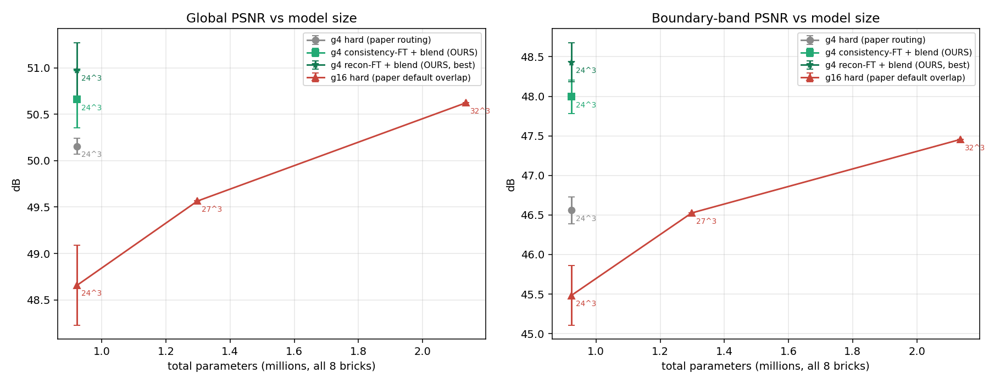

- g16 needs 2.3× the parameters (32³ grids, 8.15 MB vs 3.52 MB) to tie our global PSNR (50.62 vs 50.66 dB)
- Even then we lead by +0.40 dB in the boundary band with 444× smaller seam jumps
- g16 32³ edges our consistency variant on render PSNR (43.57 vs 43.33), recon FT + blend ties it at 43.58

> **Speaker notes:** The capacity runs are single seed, so present them as indicative. Be upfront that the biggest g16 model slightly wins render PSNR against the consistency variant.

---

## 23. Full view: capacity comparison
*Section: Results*


> **Speaker notes:** The g16 capacity sweep is shown at full size.

---

## 24. Effect of overlap width
*Section: Results*

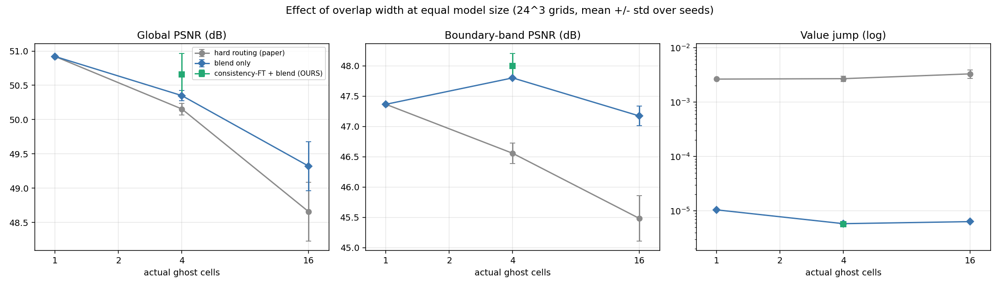

Hard routing: g1 50.92, g4 50.16, g16 48.66 dB global. Wider overlap costs capacity but does not remove the jump. Blending at g4 removes the jump.

Stored voxels relative to no overlap: g1 1.04×, g4 1.15×, g16 1.66×.

> **Speaker notes:** g1 is a single seed. We chose g4 because the blend needs room for a smooth ramp, and g1 gives only one cell. g2 remains untested because the GPU budget ran out.

---

## 25. Full view: overlap-width comparison
*Section: Results*


> **Speaker notes:** The ghost-cell sweep is shown at full size.

---

## 26. Ablation: what actually helps
*Section: Results*

- Blending alone (no training): +1.24 dB boundary, 463× lower jumps
- Short decoder fine-tune on top adds the rest
- Recon-only fine-tune control beats the consistency loss by 0.21 dB global, 0.38 dB boundary (2 seeds)
- Consistency loss lowers brick disagreement only about 3.5% vs the control

**Takeaway:** the gain comes from blending plus narrow overlap plus a short decoder fine-tune. The consistency loss stays as an ablation.

> **Speaker notes:** Say this directly, it builds trust. We planned the consistency loss as the main idea and the control showed it adds little once blending is in place.

---

## 27. Costs and tradeoffs
*Section: Results*

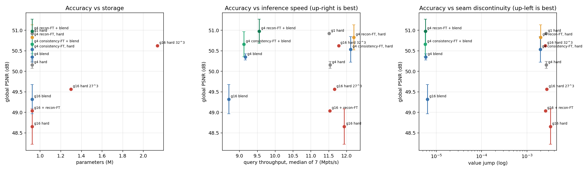

| Cost | Hard | Blend |
|---|---|---|
| Query rate | 11.5–12.2 Mpts/s | 8.7–9.6 Mpts/s (about 22% slower) |
| Frame time | 3.5–4.3 s | no consistent penalty |
| Peak GPU memory | 0.181 GB | 0.182 GB |
| Parameters | 923k | 923k |
| Extra training | none | 4–7 min fine-tune (blend alone: none) |

Base training is about 8 minutes for 8 bricks.

> **Speaker notes:** Throughput is the median of 7 rounds. The slowdown comes from evaluating several bricks for points inside the overlap. A fused CUDA kernel is listed as an extension.

---

## 28. Full view: performance tradeoffs
*Section: Results*


> **Speaker notes:** Throughput, frame time and memory are shown at full size.

---

## 29. Planned extensions
*Section: Extensions*

- **g2 overlap**: narrowest overlap where blending still works
- **More seeds and controls**: g1 seeds 1 and 2, g16 at 27³ and 32³, recon controls
- **Second dataset**: Supernova or Nyx
- **Learned blend widths**: adapt ramp width per interface
- **Fused CUDA blend kernel**: recover the 22% query slowdown
- **Blending in the paper renderer**: nerfacc and tcnn pipeline
- **Isosurface demo**: crack-free isosurfaces
- **4×4×4 on large volumes**: many bricks, multi-GPU

> **Speaker notes:** The first three are mainly compute; each needs well under an hour of GPU time. The last five are engineering extensions.

---

## 30. Limitations
*Section: Extensions*

- One dataset and one decomposition (Plume, 2×2×2)
- Some rows use one or two seeds: g1, g16 27³ and 32³, recon controls
- Renders from our own PyTorch ray marcher, not the paper's nerfacc renderer
- Blending makes queries about 22% slower in PyTorch
- Gradient jumps drop only 1.38×: values become continuous, normals still bend slightly

> **Speaker notes:** Gradient jump of ours is 2.12e-3 against a ground-truth floor of 1.75e-3, so most of the remaining gradient jump reflects real data variation.

---

## 31. Summary
*Section: Extensions*

- Seams come from a hard switch between independently trained bricks
- Smoothstep partition-of-unity blending turns it into a C1 ramp with no retraining
- 4-cell overlap plus a short decoder fine-tune beats the paper's 16-cell setting by 2 dB with the same model size
- Cost: about 22% slower queries and a few minutes of fine-tuning

**Q & A**

> **Speaker notes:** Close by restating the goal from the problem slide and that it was met: 4 ghost cells, same 923k parameters, +2 dB, seams gone. Base paper: Wurster, Xiong, Shen, Guo, Peterka, IEEE TVCG 30(1) 2024, arXiv 2308.02494.

---
